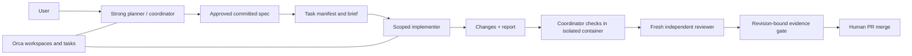

# Architecture

The spec is both the implementation contract and the file-access request. The
planner handles discovery and task design; the implementer receives a bounded
brief rather than the coordinator's entire permissions or conversation.

`plan` (`task_plan.py`) creates exact-path manifests and readable briefs. `task_scope.py`
serves only file read/write, scoped questions/mailbox and reporting. It snapshots
reviewer inputs and supervises the exact client it launched until completion,
revocation or expiry. Its prepare/probe/launch receipts bind executable and input
bytes; they are local operator evidence rather than remote attestation.

`codex_review.py` copies permitted inputs into a separate review folder and uses
a locally qualified permission profile. It owns and cleans up its child process.
`review-gate` (`review_gate.py`) rejects stale, incomplete, failed or inconsistent records. The
coordinator still verifies the actual report and receipt; a validator cannot prove
that a model read a diff or detect forged operator-controlled evidence.

The gate runner builds from a trusted committed Dockerfile and explicit inputs,
then streams a checkout snapshot into a disposable local container. No checkout
bind mount, forwarded project environment or runtime network is granted. Adopting
an application runtime is a project decision: the bundled image is deliberately
small and only supports standard-library Python checks initially.

Canonical skills are under `.agents/skills`. Claude and OpenCode files are thin
discovery adapters. The scaffolder copies an explicit manifest; it does not alter
global settings, authentication, provider subscriptions or Orca itself.

An application receives only what the workflow uses at run time: one configuration
file (`.agents/workflow.json`), the launcher, skills, agent-facing docs and the project
guide under `.agents/`, the Claude adapters, plus merged `AGENTS.md`,
`CLAUDE.md` and ignore/attribute rules. Nothing is written under the application's
`docs/`, `tests/` or `specs/`. OpenCode commands (`--opencode`) and the pre-push hook
(`--pre-push-hook`) are opt-in. The kit's own tests, human-facing docs and release
checks stay in this repository; its CI runs the runtime tests against a freshly
installed project.

## Getting started without learning the internals

The runtime is the `orca-agent-workflow` package under `src/`. A project pins one
version in `.agents/workflow.json` and runs it through `.agents/workflow.py`, which
uses the vendored copy in `.agents/runtime/` when present and otherwise
`uvx orca-agent-workflow@<version>`. Every command except `init`, `migrate` and
`review-gate` refuses to act when its version differs from the project's pin;
`review-gate` instead checks itself against the pin of the reviewed base. `init`
installs the package's `template/` (leading dots are dropped from stored paths so
packaging keeps them), previews by default and never replaces a file. The broker and
review gate read the policy with `git show <base>:.agents/workflow.json`, never from
the working tree or from a file beside the runtime, so a branch cannot widen its own
policy and workers do not see runtime code in their checkout.

The installed `workflow.py start` checks the contract, local tools and committed
checkout, then opens a fresh Orca worktree from that explicit commit. It supplies
the coordinator with the task and planning instructions; it does not launch an
implementation worker or bypass spec approval. Success requires an agent handle
and a confirmed prompt-delivery receipt. Uncertain launches are never retried as
fresh requests. `status` and dry-run previews make the next action visible without
starting a session.

## A portable setup skill

`skills/setup-orca-workflow` is the standalone distribution entry point. The Skills
CLI copies its instructions, helper and references into
the chosen agent's skill directory. It has no dependency on sibling files from
the original repository checkout.

The helper handles Orca discovery and bootstrap. The skill invokes the versioned
package through uvx. Its `init` previews the target, installs missing files with
`--apply` and writes candidates for files needing a semantic merge. The runtime
version is recorded in the application's `.agents/workflow.json`.

The agent handles project-specific decisions: preserving custom rules, reconciling
existing recovery procedures, selecting available models and configuring meaningful
checks plus a reviewed runtime. A successful file copy is explicitly not worker
readiness. The application owns its reviewed configuration after adoption.
